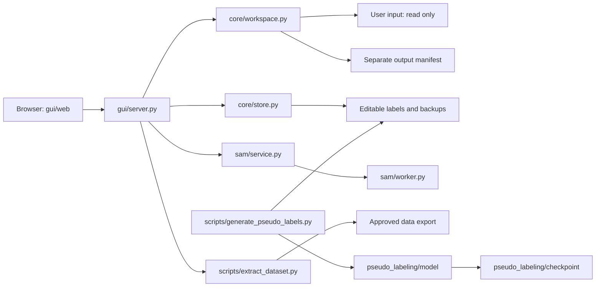

# Code structure

The GUI has no PyTorch/Ultralytics import dependency. SAM is isolated in a lazy subprocess; pseudo labeling is a separate command.

| Area | Responsibilities |
|---|---|
| `gui/server.py` | API routing, write tokens, workspace switching, local folder browser, optional SAM/export services |
| `gui/web/app.js` | Frame navigation, box/mask editing, undo/redo, review controls, keyboard shortcuts |
| `gui/web/workspace.js` | Input/output selection and server-side folder browser |
| `gui/web/labels.js` | Class settings dialog, color pickers, add/remove/restore and live application |
| `gui/web/export.js` | Export dialog, start/progress/result |
| `core/workspace.py` | Discover inputs, validate identities, create separate manifests and initial annotations |
| `core/store.py` | Label loading, validation, revisions, transactional save/rollback, review history |
| `core/label_schema.py` | Workspace class names, stable IDs, colors, reversible removal, setting revisions and backups |
| `core/io.py` | Path containment checks and atomic file writes |
| `core/dataset.py` | Manifest schema, annotation paths, existing training-data adapter |
| `core/annotations.py` | Existing class mapping, legacy instance-mask conversion and YOLO serialization |
| `core/index.py` | Rebuild label/review index files |
| `core/box_filter.py`, `core/road_filter.py` | Pure postprocessing rules |
| `sam/service.py`, `sam/worker.py` | JSON-line worker protocol, prompt validation, lazy image cache and SAM inference |
| `scripts/prepare_dataset.py` | Discover/prepare raw input folders |
| `scripts/generate_pseudo_labels.py` | Batched inference and resumable pseudo labels |
| `scripts/filter_pseudo_*.py` | Dry-run or backed-up filtering of untouched pending labels |
| `scripts/extract_dataset.py` | Approved snapshot export, ordering, integrity checks, CLI |
| `pseudo_labeling/model/yolo26.py` | Existing joint YOLO26, RGB/NIR fusion, depth and road heads |
| `pseudo_labeling/model/checkpoint.py` | Strict compatible checkpoint loading and detection decoding |
| `pseudo_labeling/model/preprocess.py` | Existing 352×640 letterbox geometry |

To change frontend layout, edit `gui/web/`. To change label storage, edit `core/store.py` and validate rollback tests. To add another pseudo-label architecture, implement its structure/loader under `pseudo_labeling/model/` and adapt the generation CLI; do not import training loops into the GUI. Dataset modalities are optional for manual editing/export, but each automatic model may require its own inputs.

The existing YOLO normalized-box format and PNG mask storage are retained. Dynamic class metadata is stored and exported as `label_schema.json`; masks can use additional class IDs. Legacy model helpers in `core/annotations.py` keep their trained class mapping independently of manual GUI settings. No training runs, dataset copies, model weights, VLM backend, external fusion source trees or original repository Git metadata are bundled.
